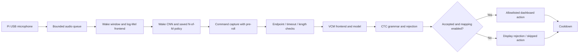

# Raspberry Pi 5: trained models to a voice dashboard

This runbook takes ME2 from flashed boot media to a dashboard running on the
Pi. The browser displays inference performed by the Pi's microphone worker.
It does not capture audio from the browser computer.

For Ubuntu installed through Imager's **Use custom** option, follow
[`RASPBERRY_PI_5_UBUNTU_WORKFLOW.md`](RASPBERRY_PI_5_UBUNTU_WORKFLOW.md).
It replaces the Raspberry Pi OS provisioning steps with Ubuntu image,
cloud-init, networking, package and audio-service instructions.

The dashboard is implemented in `src/me2/dashboard.py` and
`src/me2/dashboard_static/`. Launch it with `python -m me2.dashboard` or the
installed `me2-dashboard` command. It has no frontend build step, external
fonts, CDN assets, or additional web framework dependency.

## 0. Verify the pulled source revision before every Pi trial

Every reboot, USB re-enumeration, and audio test must run from the reviewed
revision supplied with the test handoff. Do not test a dirty worktree or a
locally edited copy. From the Pi checkout, set the branch and expected commit
from that handoff:

```sh
cd /home/me2/ME2_v2
ME2_BRANCH='master'
ME2_EXPECTED_SHA='REPORTED_COMMIT_SHA'

git status --short
git branch --show-current
git remote get-url origin
git fetch --prune origin
git pull --ff-only origin "$ME2_BRANCH"
git rev-parse HEAD
test "$(git rev-parse HEAD)" = "$ME2_EXPECTED_SHA"
```

Expected output is an empty `git status --short`, the intended branch name,
the reviewed credential-free GitHub remote, a successful fast-forward or
`Already up to date.`, and a final full SHA matching `ME2_EXPECTED_SHA`. Stop
and report instead of testing if the worktree is dirty, the branch differs,
the remote is unavailable or unexpected, `pull --ff-only` reports a conflict,
or the final SHA does not match. Do not resolve conflicts, reset, force-push,
or substitute a local archive during a Pi validation session.

Sync the already approved inference environment after the source identity is
verified. Prefer the pinned/wheelhouse installation procedure in the current
release handoff when one is supplied; otherwise the project runtime extra is:

```sh
.venv/bin/python -m pip install -e '.[microphone]'
.venv/bin/python -m pip check
```

Expected output ends with `No broken requirements found.` Stop on an install,
wheel, import, or dependency-resolution failure. Record the exact environment
only after this revision and dependency sync succeed.

For the approved Pi VCM replay, keep the reviewed WAV outside the repository
and provide it only through this local variable. The runtime log records the
decision and timing, not WAV contents; do not copy, commit, or print the
fixture path beyond this operator session:

```sh
ME2_COMMAND_WAV='/home/rpiadmin/me2-approved-fixtures/test_sample.wav'
if ! test -r "$ME2_COMMAND_WAV"; then
  echo 'STOP: approved command fixture is missing or unreadable.' >&2
  exit 1
fi
```

Expected output is silent with exit status zero. Stop if the fixture check
fails; do not substitute a repository sample or an unreviewed recording.

## 1. Finish training and choose a release

**Current status, 2026-10-06:** no wake artifact has passed deployment review.
The supplied `config/dashboard.json` identifies the preliminary
`wake_word_v5_regularized_seed43.me2`, whose
`deployment_ready=false` blocks live listening by default. The selected
`vcm_ctc_model.me2` is the legacy `CharacterAudioCNN`, not the preliminary
compact CTC model. See `IMPROVEMENT_CYCLE_2026-10-06.md`.

Hardware setup and synthetic dashboard testing can proceed now. Before
unattended listening, select approved artifacts using:

- Pronunciation-reviewed complete `ateko` positives, pronounced `a-teh-ko`;
  independent real speakers and continuous negative audio.
- Frozen training/validation/calibration partitions, documented operating
  thresholds, and a separate deployment assessment. Do not tune on test or
  repeatedly use holdout for model selection.
- Wake event recall, false activations/hour, command false accepts/rejects,
  wrong accepted actions, and end-to-end success appropriate to the intended use.
- An explicit record of selected model paths, SHA-256 hashes, training
  revision, model/grammar versions, evaluation results, and readiness approval.
  Missing readiness metadata is not evidence of approval.

Do not rename an experimental model as “approved” or edit its readiness flag
to bypass review. The explicit engineering override described below is only
for supervised development.

```mermaid
flowchart LR
  A[Train, calibrate, select] --> B[Freeze release and hashes]
  B --> C[Flash Raspberry Pi OS]
  C --> D[Configure OS and microphone]
  D --> E[Install ME2 and model bundles]
  E --> F[WAV checks and Pi benchmark]
  F --> G[Demo dashboard]
  G --> H[Live wake and command test]
  H --> I[Map accepted intents]
  I --> J[Service, soak test, release approval]
```



## 2. Prepare and flash boot media

Use a Pi 5, a microSD card and reader, a USB microphone, network access, and a
suitable power supply. Raspberry Pi recommends its 27 W USB-C supply for Pi 5.
For this workflow, allow 32 GB or more for the OS, Python environment and
logs; use active cooling for sustained inference measurements. [S1, S2]

On the workstation:

1. Install Raspberry Pi Imager from the official Raspberry Pi software page.
2. Select **Raspberry Pi 5**, **Raspberry Pi OS Lite (64-bit)**, and the
   intended microSD card. Desktop 64-bit is an alternative for a directly
   attached display.
3. Customize hostname `ateko-pi`, username `me2`, a strong password, timezone
   `Asia/Manila`, Wi-Fi/country if needed, and SSH with your public key.
4. Check the selected storage device carefully: writing erases that device.
   Write, verify, safely eject, and insert it into the powered-off Pi.
5. Connect cooling, microphone and Ethernet if used, then power on. [S1]

The remaining examples use `me2@ateko-pi.local` and
`/home/me2/ME2_v2`. Substitute your actual account, host and directory
consistently, including the service file.

For the first build, microSD keeps the boot path simple. USB SSD/NVMe is an
optional later migration; verify bootloader and boot-order requirements in
the official hardware documentation for that storage choice. [S2]

## 3. First boot and OS packages

Connect from the workstation:

```sh
ssh me2@ateko-pi.local
```

If `.local` resolution is unavailable, use the Pi's address from your router.
Run the following **on the Pi**:

```sh
uname -m
getconf LONG_BIT
cat /etc/os-release
sudo apt update
sudo apt full-upgrade -y
sudo apt install -y python3-venv python3-pip libportaudio2 libsndfile1 \
  alsa-utils rsync
sudo timedatectl set-timezone Asia/Manila
sudo usermod -aG audio me2
sudo reboot
```

Reconnect after reboot. Expect `aarch64` and `64`, and confirm the OS image
supports Pi 5. The `audio` group gives the later system service access to
ALSA devices. PortAudio is the Linux system dependency for `sounddevice`;
installing it does not select a microphone automatically. [S3]

## 4. Transfer the source and the selected artifacts

This checkout can contain uncommitted source and untracked model bundles.
Cloning only its Git commit would omit those files. From the **workstation
repository root**, transfer the deployment subset explicitly:

```sh
ssh me2@ateko-pi.local \
  'mkdir -p ~/ME2_v2/wake-word/models ~/ME2_v2/vcm/models ~/ME2_v2/fixtures'
rsync -av --exclude '__pycache__' --exclude '*.egg-info' \
  pyproject.toml README.md src config docs deploy \
  me2@ateko-pi.local:/home/me2/ME2_v2/
rsync -av wake-word/models/wake_word_v5_regularized_seed43.me2 \
  me2@ateko-pi.local:/home/me2/ME2_v2/wake-word/models/
rsync -av vcm/models/vcm_ctc_model.me2 \
  me2@ateko-pi.local:/home/me2/ME2_v2/vcm/models/
```

These are **current engineering fixtures**, not a promoted release. Once
approved models exist, transfer those instead and update both model paths in
`config/dashboard.json`. Paths in that file are relative to its directory.
CLI `--wake-model` and `--vcm-model` overrides are relative to the shell's
working directory.

For this approved Pi procedure, copy only the independently reviewed wake WAV
as `fixtures/wake.wav`. Keep the approved command WAV at the separately
controlled external path defined by `ME2_COMMAND_WAV` in section 0; do not
copy it into the repository. Keep command-without-wake and out-of-scope clips
in their separately controlled test location. Do not transfer the
workstation's `.venv`, training datasets, legacy pickles, or experimental
model collection.

Record hashes for the exact selected bundles on the workstation (macOS):

```sh
shasum -a 256 wake-word/models/wake_word_v5_regularized_seed43.me2 \
  vcm/models/vcm_ctc_model.me2 > deployment-models.sha256
scp deployment-models.sha256 me2@ateko-pi.local:/home/me2/ME2_v2/
```

Verify **on the Pi**, changing filenames above when selecting another release:

```sh
cd /home/me2/ME2_v2
sha256sum -c deployment-models.sha256
mkdir -p logs results dashboard-state
```

## 5. Install the inference environment

On the Pi:

```sh
cd /home/me2/ME2_v2
python3 -m venv .venv
.venv/bin/python -m pip install --upgrade pip
.venv/bin/python -m pip install --only-binary=:all: torch
.venv/bin/python -m pip install -e '.[microphone]'
.venv/bin/python -c \
  'import platform, torch; print(platform.machine(), torch.__version__); print(torch.ones(2) + 1)'
.venv/bin/python -m pip freeze > results/pi5-environment.txt
```

Use a stable Linux ARM64 wheel compatible with the installed Python version.
If the binary-only install reports no compatible distribution, consult the
current official PyTorch installation selector and supported Python versions;
use a supported 64-bit OS/Python combination. This workflow does not require
CUDA, `torchvision`, `torchaudio`, or building PyTorch on the Pi. [S4]

The project declares Python 3.10+ and Torch 2.2+; those lower bounds do not
guarantee that every Python/OS combination has a current wheel. Record the
versions actually tested on the Pi and retain its environment report with
the release. Inference startup does not download models or datasets.

## 6. Identify and verify the microphone

On the Pi, start with the repository's discovery helper. It only lists ALSA
devices and processes that currently hold audio nodes; it does not open a
capture stream or save audio:

```sh
scripts/pi5_audio_capture_check.sh --inspect
PYTHONDONTWRITEBYTECODE=1 PYTHONPATH=src .venv/bin/python -m me2.health \
  --config config/runtime.pi5.natural-pause.json --devices --playback-devices
```

Choose a **named** capture PCM shown by `arecord -L`, such as
`plughw:CARD=Device,DEV=0`. Do not assume `plughw:0,0`: numeric card IDs can
change across boots or USB ports. The corresponding `arecord -l` entry must
be a capture device, and `/proc/asound/pcm` must include `capture 1`.

The Pi profiles now use `audio_backend: "auto"` and `alsa_device: "auto"`.
At runtime, ME2 first validates the shared system/default microphone through
PortAudio (normally PipeWire/PulseAudio-managed). If that path is unavailable,
it enumerates ALSA capture devices and selects the one unambiguous candidate
as a named `plughw:CARD=...,DEV=...` PCM. It never persists a numeric card
number. With two matching devices, it fails with `ambiguous_capture_device`;
set `alsa_device` to `name:UNIQUE_NAME_FRAGMENT` or an explicit named ALSA
PCM. `default` intentionally uses the shared ALSA default; `arecord` remains
the explicit direct-hardware fallback.

Check that the selected PCM can provide the bundle's required format without
saving audio:

```sh
scripts/pi5_audio_capture_check.sh --probe \
  --device 'plughw:CARD=Device,DEV=0'
```

The current bundles require **16 kHz mono** input. `plughw` is normally
preferable because it can convert a USB microphone's native format. The live
stream does not resample a native 48 kHz microphone stream itself. File
inference does support resampling.

Only after separate operator approval, make one bounded, local capture for
level/channel validation. The helper requires the approval variable, writes
only under `results/`, refuses to overwrite a file, prints technical signal
metrics only, and the generated WAV path is Git-ignored:

```sh
ME2_AUDIO_CAPTURE_APPROVED=1 scripts/pi5_audio_capture_check.sh \
  --record --device 'plughw:CARD=Device,DEV=0' \
  --output "results/microphone-check-${ME2_RUN_ID:-manual}.wav"
```

Expected output reports `sample_rate: 16000`, `channels: 1`, a duration near
eight seconds, and nonzero RMS while speaking. Peak values near `1.0` indicate
clipping. Delete the recording when validation is complete; do not commit or
copy it into a test fixture.

If direct ALSA capture returns `Device or resource busy`, inspect the holder
before changing any service:

```sh
sudo fuser -v /dev/snd/*
sudo lsof /dev/snd/*
systemctl --user --type=service --state=running | grep -Ei 'pipewire|wireplumber|pulse'
```

An existing ME2/`arecord` process can be stopped only after its PID and command
line have been confirmed. A desktop Pi commonly has PipeWire holding the USB
PCM. First, when `pw-record` is installed, validate PipeWire capture without
disrupting desktop audio. Obtain the USB source node ID from `wpctl status`;
the bounded command may return status `124` because `timeout` intentionally
ends it. Validate the resulting WAV without printing its contents:

```sh
command -v pw-record
wpctl status
ME2_AUDIO_CAPTURE_APPROVED=1 timeout --signal=INT --kill-after=2s 10s \
  pw-record --target SOURCE_NODE_ID --rate 16000 --channels 1 \
  "results/pipewire-microphone-check-${ME2_RUN_ID:-manual}.wav"
scripts/pi5_audio_capture_check.sh --validate \
  --input "results/pipewire-microphone-check-${ME2_RUN_ID:-manual}.wav"
```

This verifies the physical microphone and PipeWire source, but it does not
make ME2's direct `arecord` backend share the device. Alternatively, try the
advertised shared ALSA endpoint, for example `dsnoop:CARD=Device,DEV=0`, with
the same probe or approved-record command. If direct `plughw` capture is
specifically required, stop **only** the identified per-user
PipeWire/WirePlumber units, retry the bounded check, and restore them
immediately:

```sh
systemctl --user stop wireplumber.service
systemctl --user stop pipewire-pulse.service
systemctl --user stop pipewire.service

# Run the approved direct-ALSA check here.

systemctl --user start pipewire.service
systemctl --user start wireplumber.service
systemctl --user start pipewire-pulse.service
```

This temporarily disrupts desktop audio. Do not indiscriminately kill audio
services. If socket activation restarts PipeWire, inspect and, only for the
short test, stop `pipewire.socket` and `pipewire-pulse.socket`; start both
again before returning the Pi to normal use. A Pi 5 has no built-in analog
microphone capture input: the USB microphone/audio interface or installed I2S
capture hardware must appear in ALSA before ME2 can use it.

Playback is selected separately. The optional wake chime defaults to disabled;
when enabled with `alsa_device: "auto"`, the dashboard enumerates playback
devices and validates exactly one candidate before inference. Multiple output
candidates fail with `ambiguous_playback_device`; configure a stable
`name:UNIQUE_NAME_FRAGMENT` selector instead. This avoids selecting an HDMI
output merely because it has the lowest card number.

Keep the microphone clear of the cooling fan and speakers. Do not run the
CLI and the dashboard microphone worker simultaneously.

## 7. Check models before integrating the UI

On the Pi, always pass both model paths explicitly for CLI replay:

```sh
.venv/bin/python -m me2.app --interactive \
  --wake-model wake-word/models/wake_word_v5_regularized_seed43.me2 \
  --vcm-model vcm/models/vcm_ctc_model.me2 \
  --wake-audio fixtures/wake.wav \
  --command-audio "$ME2_COMMAND_WAV"
```

This two-file check verifies loading and a simple wake gate. It is not a
continuous-microphone or smoothing benchmark. A failed wake may reflect the
current model's limitations rather than an installation failure.

Benchmark both artifacts on the actual Pi:

```sh
.venv/bin/python -m me2.benchmark fixtures/wake.wav \
  --model wake-word/models/wake_word_v5_regularized_seed43.me2 \
  --iterations 200 --threads 2 --output results/pi5_wake_benchmark.json
.venv/bin/python -m me2.benchmark "$ME2_COMMAND_WAV" \
  --model vcm/models/vcm_ctc_model.me2 \
  --iterations 200 --threads 2 --output results/pi5_vcm_benchmark.json
vcgencmd measure_temp
vcgencmd get_throttled
```

Compare one and two Torch threads if necessary. Keep each result separately.
The benchmark reports inference stages and memory; it excludes microphone
capture and endpoint waiting. `vcgencmd` provides target temperature and
throttling diagnostics; use the official bit definitions when interpreting
historical versus current throttling flags. [S7]

## 8. Run the dashboard in synthetic mode

On the Pi, or in the workstation virtual environment:

```sh
python -m me2.dashboard --demo --autostart
```

Use `.venv/bin/python` if the environment is not activated. Open
`http://127.0.0.1:8765` in a browser on the same machine. From the workstation
to a headless Pi, keep this SSH tunnel open:

```sh
ssh -N -L 8765:127.0.0.1:8765 me2@ateko-pi.local
```

Then open `http://127.0.0.1:8765` on the workstation. Stop a local dashboard
using that port before opening the tunnel. The server binds to IPv4 loopback
and checks the HTTP host and request token. Use the same port at both ends
of the tunnel, or change the server and both tunnel ports together.

In the dashboard:

1. Choose `light_on` and **Send example**. Observe wake → capture → decode →
   result → cooldown, and the simulated light turning on.
2. After cooldown, choose `light_off` and **Try rejection**. The light must
   remain on.
3. Disable `light_off` in the mapping table and **Save mappings**. Send an
   accepted `light_off` example; its action must be skipped.
4. Re-enable and save it. Test **Stop**, then **Start listening**.
5. Refresh the browser: mappings remain saved; audio processing belongs to
   the server, so closing the browser does not stop it.

Demo mode uses synthetic waveforms/predictors with the real state machine.
Its scores and decoded text are examples, not accuracy measurements.

## 9. Connect the dashboard to the live models

Stop the demo server with Ctrl+C. Set `input_device` and selected model
paths in `config/dashboard.json`, then run:

```sh
.venv/bin/python -m me2.dashboard --config config/dashboard.json
```

Press **Start listening**. The worker loads the `.me2` bundles, validates
their task types and sample-rate agreement, checks the microphone, and
publishes state changes. **Current preliminary wake artifacts will report a
readiness error.** If a supervised engineering microphone test is intended:

```sh
.venv/bin/python -m me2.dashboard \
  --config config/dashboard.json \
  --allow-unverified-wake-model
```

The override appears in the dashboard notice. It does not approve the model,
change its thresholds, or establish deployment quality.

The audio chain is:



The CLI and dashboard share `app.build_streaming_pipeline()`,
`StreamingPipeline`, `WakeEventDetector`, and `predict_command()`.
Only the complete `ateko` label can trigger the wake gate; isolated `a`,
`te`, and `ko` never count as complete-word hits.

The dashboard polls JSON every 400 ms, independently of audio capture. It
shows RMS level, latest wake score, stage, acceptance/rejection, recognized
intent, supported slots, selected action, process CPU/RSS, Pi temperature
when available, model hashes/versions and up to 80 recent events.
Short states can fall between polls; the timeline retains them. Scores are
diagnostics, not calibrated correctness probabilities.

## 10. Map command intents to UI actions

All 19 dataset intents appear in the table. The “Model support” column is
derived from the loaded grammar/labels. Saved enable/disable settings live in
`dashboard-state/mappings.json`; writes are atomic and survive a server
restart. Each intent has one fixed canonical dashboard action. Historical
`display` entries are upgraded in memory; the file changes only after save.

| Recognized intent | Default dashboard action |
| --- | --- |
| `light_on`, `light_off` | Set in-memory demo light state |
| `play_music`, `pause`, `stop`, `next`, `volume_up`, `volume_down` | Control an original generated sample track and dashboard player state; volume is bounded to 0–100 |
| `weather` | Fetch a current observation for the configured city; show loading, cached/stale data, or an error |
| `time` | Display current host-local time |
| `call`, `message` | Show a simulated ringtone/message status; never place a call or send a message |
| `list_reminders`, `create_reminder`, `timer`, `alarm` | Update local demonstration lists only |
| `brightness`, `color`, `temperature` | Update local brightness, color, and thermostat preview state |

The UI allows disabling an intent. Rejected results, system errors, unknown
intents, disabled mappings, duplicate utterance IDs, and invalid or unsupported
slots cannot mutate action state. Stopping also suppresses an inference that
finishes during shutdown. Synthetic dashboard results are labeled as such and
are not speech-recognition evidence.

The retained legacy CTC grammar does not carry semantic slot mappings. The
dashboard therefore fails closed for slot-dependent live actions when no
supported value is supplied; it does not infer a color, number, contact, or
time from the transcript. The synthetic dashboard uses fixed sample slots for
UI demonstration only. Inspect the loaded grammar panel before using a
slot-dependent action.

Weather is optional network functionality; speech inference remains local and
does not download a model or dataset. The configured default city is Manila;
change `weather.city` in `config/dashboard.json` for your deployment. The
service uses public geocoding/current-observation endpoints with a bounded
timeout and in-memory cache. No credential is stored. Network failure shows
a safe error or stale cached reading. Configure `music.playback_enabled` and,
if needed, `music.output_device`; output opens only after an accepted action.
The sample melody and simulated call ringtone are generated locally. The
synthetic dashboard demo does not play audio.

Timers, alarms, messages, calls, lighting, brightness, color, and thermostat
changes are UI demonstrations, not real communications, GPIO, or appliance
control. Do not connect physical actions without a separately reviewed,
allowlisted backend and safety tests.

The natural-pause candidate at `config/dashboard.natural-pause.json` uses the
same artifacts and decoder/rejection policy as `config/dashboard.json`; its
only streaming change is onset timeout 1000→3000 ms. The CLI counterpart is
`config/runtime.onset-3s.json`. Neither is promoted by configuration alone:
the combined endpoint/max-duration experiment previously produced an OOS
false accept in development replay.

## 11. Start the dashboard on boot

After foreground verification, install the supplied unit on the Pi. The
template assumes account/group `me2`, this checkout path, and direct ALSA
access. If using a desktop session's audio server instead, verify its
service-session access separately.

```sh
cd /home/me2/ME2_v2
mkdir -p logs dashboard-state
sudo cp deploy/raspberry-pi/me2-dashboard.service /etc/systemd/system/
sudo systemctl daemon-reload
sudo systemctl enable --now me2-dashboard.service
systemctl status me2-dashboard.service --no-pager
journalctl -u me2-dashboard.service -n 80 --no-pager
```

Stop the foreground dashboard first to release port 8765. The service runs
unprivileged, starts the microphone worker with `--autostart`, and contains
no readiness override. With the supplied unapproved wake model, the server
stays available to display the readiness error and the microphone remains
closed. Automatic process restart does not resolve a model-readiness or
microphone-worker error; inspect the dashboard/logs and correct the cause.
Before live Pi trials, first run the synthetic UI demo and file-based pipeline
check. Obtain operator approval before each microphone or speaker trial, state
the exact phrase and “GO” cue, and use local/mock actions only. Current wake
artifacts remain unapproved and do not meet the production readiness gate.

`Restart=on-failure` restarts the process after an abnormal process exit;
systemd sends the process its termination signal when stopping. [S6]

```sh
sudo systemctl restart me2-dashboard.service
sudo systemctl stop me2-dashboard.service
sudo systemctl disable me2-dashboard.service
```

Dashboard events also go to rotating `logs/dashboard.log`. Raw audio is
not stored by the dashboard. Event messages can contain recognized intents.
The local HTTP server is intended for this single-device workflow; remote
access uses the SSH tunnel. On a Pi with a desktop, a local browser can open
the same loopback address; a kiosk is optional and is not installed by this runbook.

## 12. Acceptance, maintenance and rollback

Before calling a release deployed, record outcomes on the actual Pi:

| Check | Expected behavior / evidence to retain |
| --- | --- |
| Boot and reboot | Service starts; expected model hashes; configured mic opens |
| Wake alone | Command onset timeout; no action |
| Command without wake | No command inference/action |
| Wake + known command | One accepted intent/action; returns to wake listening |
| Wake + OOS / unsupported utterance | Rejection; no action |
| Isolated syllables / room noise | No complete-word wake event |
| Immediate command after wake | Pre-roll preserves onset; test real speech |
| Overlong / truncated command | Rejection; no action |
| Disabled mapping | Recognition visible, action skipped |
| Stop during decoding | No subsequent device action; worker releases mic |
| Microphone unplug/replug | Fault visible, partial audio discarded, bounded retry |
| Browser reconnect | Current state returns; no second microphone worker |
| Sustained workload | Record real CPU/RSS, temperature, throttling and dropouts |

Use a predeclared soak duration (for example 30–60 minutes for an initial
engineering check) and separately sufficient continuous negative audio for
the intended false-activation estimate. Report actual counts, recording
conditions and uncertainty; a short demonstration is not a quality claim.
Measure complete wake-to-action latency as well as model-stage latency.

Keep each approved source/config/model release in a separate directory and
retain its hash manifest, Pi environment report and validation results.
Before an update, stop the service; copy and verify the next release,
run its foreground smoke checks, and update the unit paths consistently.
For rollback, restore the previous tested paths, run
`sudo systemctl daemon-reload`, and restart. Preserve mappings separately
when they are compatible with the previous action schema.

| Symptom | Next check |
| --- | --- |
| Pi does not boot | Correct target media/image, write verification and power [S1] |
| Cannot connect over SSH | Imager SSH/user settings, network, router address [S1] |
| Torch has no wheel | 64-bit OS, supported Python, official stable wheel [S4] |
| PortAudio missing | `libportaudio2` installation and the active venv [S3] |
| Invalid sample rate/device | Re-run enumeration and 16 kHz input-format check [S5] |
| Readiness error | Approved wake release or explicit supervised engineering override |
| No slots | Loaded artifact's grammar may not encode them |
| Overflow / slow decode | Pi stage benchmarks, threads, CPU load, cooling; do not just enlarge the queue |
| Web page unreachable | Service status, port conflict, SSH tunnel and local host/port |
| Service cannot save logs/mappings | Correct ownership and unit `ReadWritePaths` |

## Primary references

Implementation verification on the development Mac, 2026-10-06: 55 tests
passed, Ruff passed, and JavaScript syntax validation passed. Browser checks
covered accepted/rejected demo commands, saved and disabled mappings,
stop/restart, and a 390-pixel layout without page overflow. Actual selected
bundles loaded and the unapproved wake artifact was blocked before microphone
access. Pi boot, systemd, USB microphone behavior, and Pi performance still
require verification on the target hardware.

Consulted 2026-10-06; installation UI labels and supported package versions
can change. These references support the platform steps; repository-specific
behavior is implemented in the files described above.

- **S1 — Raspberry Pi getting started:** `https://www.raspberrypi.com/documentation/computers/getting-started.html`
- **S2 — Raspberry Pi hardware, cooling, boot and diagnostics:** `https://www.raspberrypi.com/documentation/computers/raspberry-pi.html`
- **S3 — sounddevice installation:** `https://python-sounddevice.readthedocs.io/en/latest/installation.html`
- **S4 — PyTorch installation:** `https://docs.pytorch.org/get-started/locally/`
- **S5 — sounddevice hardware checks:** `https://python-sounddevice.readthedocs.io/en/latest/api/checking-hardware.html`
- **S6 — systemd service semantics (upstream source):** `https://github.com/systemd/systemd/blob/main/man/systemd.service.xml`
- **S7 — Raspberry Pi OS diagnostics:** `https://www.raspberrypi.com/documentation/computers/os.html#vcgencmd`
